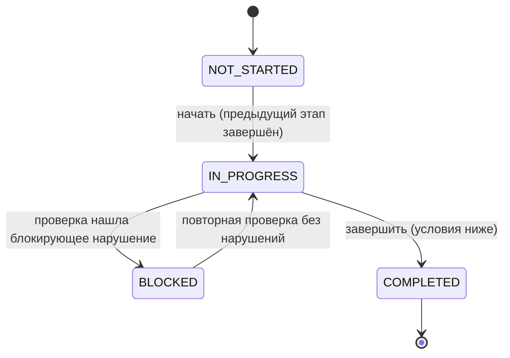

# Конечный автомат запуска

Четыре этапа строго по порядку: `METER_HISTORY → REALTIME_TELEMETRY → ASSET_CONTROL → FINAL_DASHBOARDS`.
Реализация – `src/engine/state-machine/machine.ts` (переходы) и `guards.ts` (условия).

## Условия завершения этапа

| Отказ | Когда |
| --- | --- |
| `PREVIOUS_STAGE_NOT_COMPLETED` | Предыдущий этап не завершён (в отказе – перечень незакрытых этапов) |
| `VALIDATION_NOT_RUN` | Проверки этапа не запускались или результат неактуален после изменения входов |
| `VALIDATION_FAILED` | Блокирующее правило провалено или пропущено (источник недоступен – тоже провал) |
| `OPEN_BLOCKERS` | Есть открытые препятствия |
| `MISSING_CONFIRMATIONS` | Нет обязательных подтверждений нужной роли с допустимыми материалами, или они устарели |
| `RULESET_MISMATCH` | Сессия зафиксирована на другой версии правил |
| `ACCESS_DENIED` | У роли нет права на действие (оператор не может публиковать и принимать) |

Каждый переход и каждый отказ записываются в журнал аудита; записи только добавляются.

## Препятствия

Проваленное блокирующее правило открывает препятствие и переводит этап в `BLOCKED`. Повторная проверка без
нарушения закрывает его (`RESOLVED`), запись остаётся в истории. Вручную препятствие проверки можно только
снять с обоснованием (`WAIVED`).

## Устаревание подтверждений

Изменение уже проверенного входа делает зависимые подтверждения неактуальными (`staleSince`, `staleReason`)
и запускает повторную проверку начатых этапов:

| Вход | Затронутые этапы |
| --- | --- |
| invoice.csv | 1, 4 (блок «История учёта») |
| object.json (паспорт) | 1–4 |
| telemetry.csv | 2, 3, 4 |
| тест управления | 3–4 |
| публикация дашборда | 4 |

Устаревшие подтверждения не засчитываются, но остаются в истории.

Завершённый этап при этом не переоткрывается, но:

- следующий этап нельзя завершить, пока у предыдущих этапов есть устаревшие подтверждения
  (`MISSING_CONFIRMATIONS`, `details.staleStages`) – запуск не идёт дальше на подтверждениях к старым данным;
- устаревшее подтверждение завершённого этапа обновляется кнопкой «Обновить подтверждения» на странице этапа
  (`renewConfirmation()`): проверки этапа выполняются заново на текущих данных, и подтверждение засчитывается
  только без блокирующих ошибок (иначе `VALIDATION_FAILED`). Работает и после завершения запуска: изменение
  данных снимает готовность, обновлённое подтверждение её возвращает. Следующее действие объекта в этом случае –
  «Обновить устаревшие подтверждения этапа».

## Итоговая готовность

`objectReadiness()` (`engine/dashboards/readiness.ts`): объект готов, только если все 4 этапа завершены,
действующая конфигурация дашбордов принята ответственным и ни одно подтверждение не устарело.
Только тогда интерфейс и протокол показывают «Объект готов к эксплуатации».
